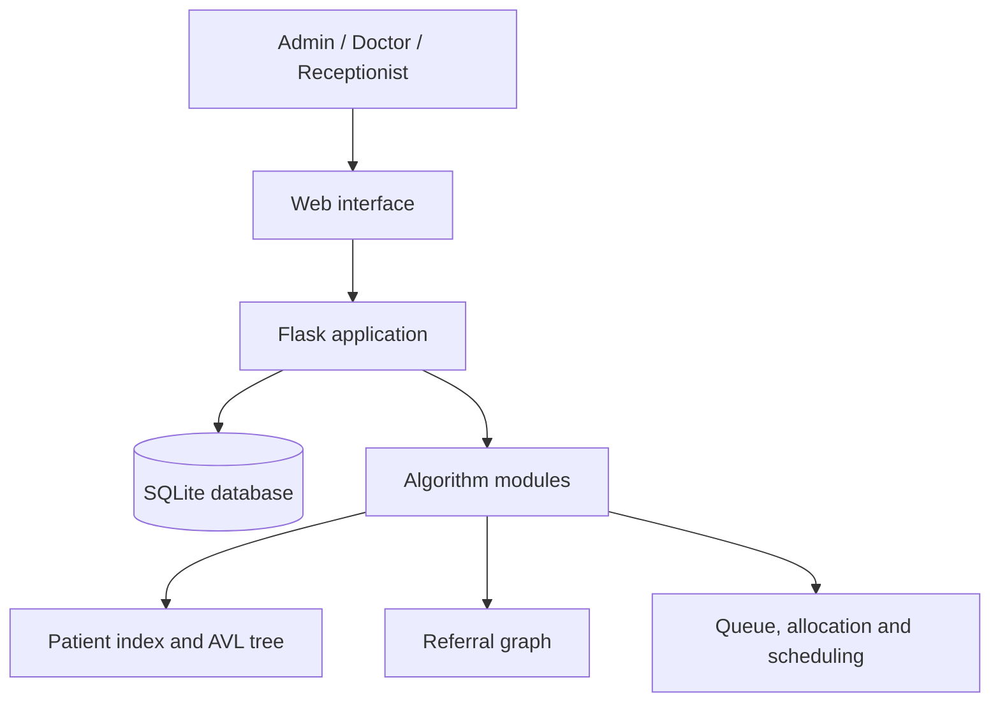

# System Architecture

## Component purpose

| Component | Responsibility |
|---|---|
| Web interface | Forms, tables, charts and interactive demonstrations |
| Flask application | Serves the website and validates database requests |
| SQLite database | Stores patients, doctors, appointments, resources and history |
| Algorithm modules | Provides readable implementations for evaluation and viva |
| Local browser storage | Used only by the hosted demonstration version |
